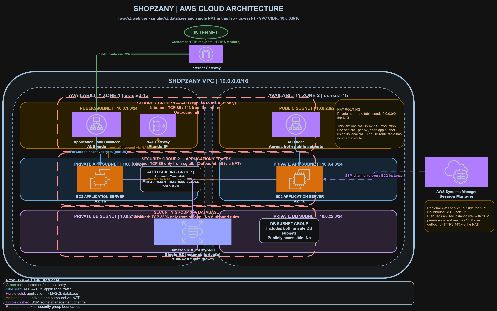
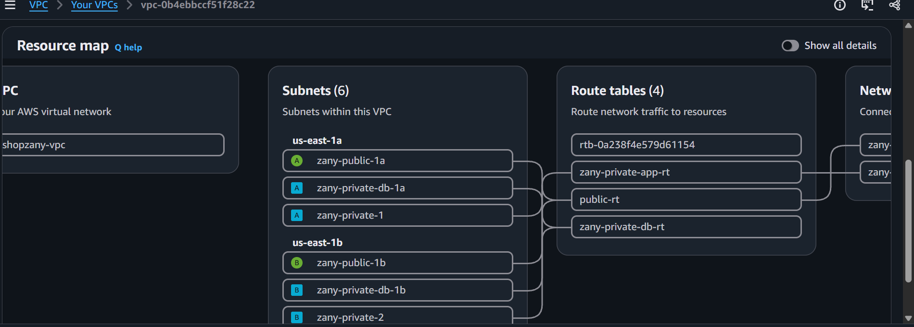
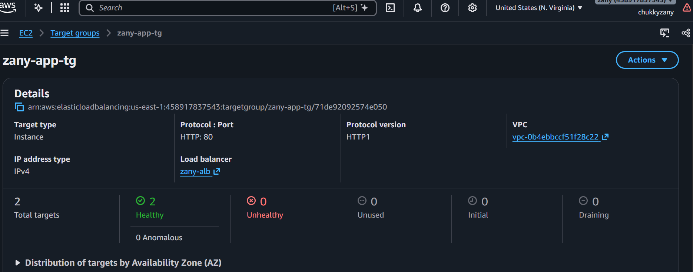
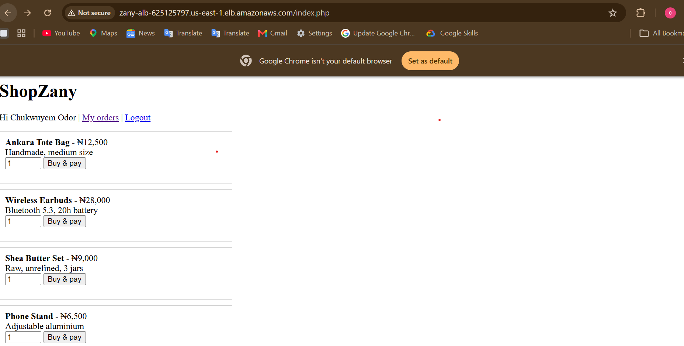
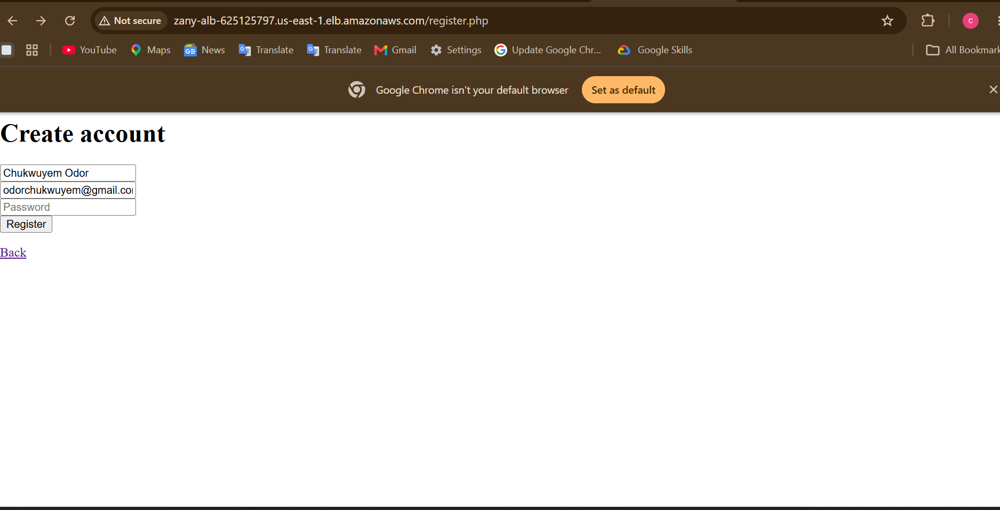
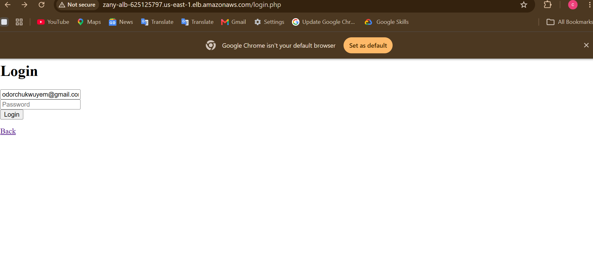
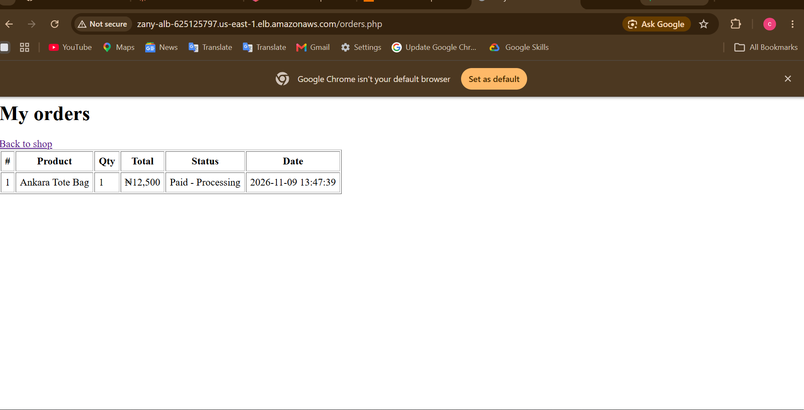
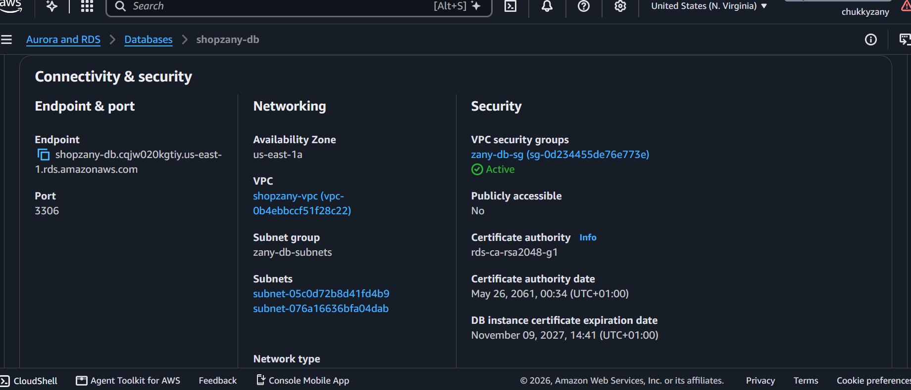
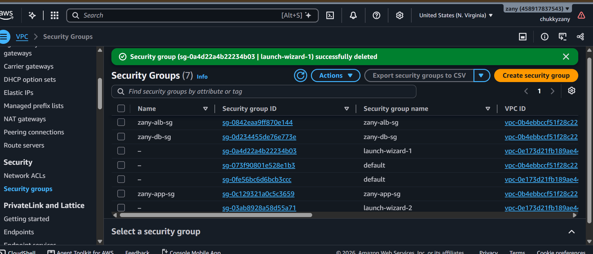
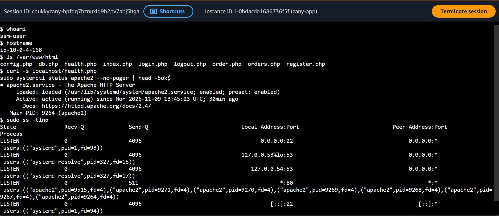

# ShopZany: Launching an Online Store on AWS, Securely

## The problem

ShopZany is a Nigerian e-commerce startup that wants to launch an online shop. Customers need to be able to browse products, create accounts, place orders, pay, and track what they ordered. They expect around 2,000 visitors a day at the start, and they want room to grow.

The business had a few non-negotiables:

- The shop must be reachable from the internet.
- The customer database must **never** be exposed to the internet.
- Only the ports that are really needed should be open.
- Everything must live inside a private network (a VPC).
- The setup has to handle growth without a rebuild.
- Admin access must be locked down.

## My solution

I designed a three-tier architecture on AWS and built the whole infrastructure with Terraform, so it can be created, reviewed and destroyed with a few commands. The idea is simple: customers only ever talk to a load balancer, the shop's servers hide in private subnets behind it, and the database hides one layer deeper, where only the servers can reach it.



The store itself is a small PHP app that lives in its own repo: [shopzany-app](https://github.com/chukkyzany/shopzany-app). The servers pull it from GitHub when they start.

---

## Step 1: Build the network

Everything starts with a VPC (`10.0.0.0/16`) spread across two Availability Zones, so one data-center problem doesn't take the shop down. Inside it I created six subnets, two for each layer:

| Layer | AZ 1a | AZ 1b | Internet traffic goes to |
|---|---|---|---|
| Public | 10.0.1.0/24 | 10.0.2.0/24 | Internet Gateway |
| Private app | 10.0.3.0/24 | 10.0.4.0/24 | NAT Gateway |
| Private database | 10.0.21.0/24 | 10.0.22.0/24 | Nowhere (local only) |

What makes a subnet "public" is its route table, not its name: a public subnet has a route to the Internet Gateway. The app subnets can only reach the internet outward, through a NAT Gateway, so servers can download updates while nobody on the internet can start a connection to them. The database subnets have no internet route at all.

I kept the app and the database in separate subnets on purpose. They need different rules, and separate route tables give me a second layer of protection on top of the security groups.



---

## Step 2: Open one front door

Customers reach the shop through an Application Load Balancer sitting in the two public subnets. It's the only thing on the internet that faces customers. When a request arrives:

1. The browser sends it to the ALB's public address, and it enters the VPC through the Internet Gateway.
2. The ALB's security group checks it and allows it on port 80.
3. The listener forwards it to a target group, which picks a healthy server and sends it to that server's private IP.

The load balancer checks each server every 30 seconds on a small `/health.php` page and stops sending traffic to any server that fails. Here are both servers reporting healthy:



And this is the shop, loading through the load balancer's address:



---

## Step 3: Run the shop on private servers

The shop runs on EC2 servers managed by an Auto Scaling Group. It keeps at least two servers running, one per Availability Zone, and can grow to four. The servers have **no public IP address**. Nothing on the internet can reach them directly. Their only way in is through the load balancer.

A new server sets itself up at boot: it installs Apache and PHP, pulls the app from GitHub, and writes the database settings into a config file. If a server dies, the Auto Scaling Group replaces it with a fresh one.

Customers can create an account:



And sign in:



After placing an order, they can track it on their own orders page. This also proves that the whole chain works, from the browser to the load balancer to a private server to the database and back:



(Payment is simulated in this version. See the limits section below.)

---

## Step 4: Protect the database

The customer data lives in Amazon RDS for MySQL, in the private database subnets. It has no public IP address, no route to the internet, and a security group that only accepts connections from the app servers.

When a page needs data, the PHP code connects to the database's endpoint on port 3306. Two things have to be true for that to work:

1. **The security group allows it.** The database's group accepts port 3306 only from the app servers' group, and the app servers' group allows the connection out.
2. **There's a network path.** Both tiers are in the same VPC, so the built-in local route connects them. That route is also the only way in, because the database subnets have no other routes.

The app connects to the endpoint **name**, not a fixed IP address, because the IP behind a managed database can change during maintenance or a failover, while the name stays valid.

The RDS console confirms that it is not publicly accessible:



---

## Step 5: Lock down the ports

Three security groups chain the layers together. Each one trusts only the layer in front of it:

| Security group | Allows in | From | Allows out |
|---|---|---|---|
| ALB | TCP 80, 443 | The internet | All |
| App servers | TCP 80 | The ALB's group | All (reaches the internet through the NAT) |
| Database | TCP 3306 | The app servers' group | None |

I used security groups as sources instead of IP ranges. It's stricter, because only members of that group can connect, and it keeps working when servers scale and their IP addresses change. Security groups are also stateful, so replies to allowed requests flow back without extra rules.



---

## Step 6: Secure administrator access

There is no SSH anywhere. Port 22 is closed on every security group, so there is no door to attack or leave open by mistake. Admins connect through AWS Systems Manager Session Manager instead. Each server has an IAM role that lets it register with Systems Manager, and an admin opens a shell from the AWS console, with every session logged and tied to an IAM identity.



---

## Did it solve the problem?

| What ShopZany needed | How it's covered |
|---|---|
| Reachable from the internet | Internet-facing load balancer in the public subnets |
| Database never exposed | Private subnets, no internet route, no public IP, security group trusts only the app servers |
| Only necessary ports open | 80/443 on the ALB, 80 from the ALB to the servers, 3306 from the servers to the database, nothing else |
| Inside a VPC | Custom VPC across two Availability Zones |
| Room to grow | Auto Scaling Group from 2 to 4 servers, plus the upgrades listed below |
| Secure admin access | Session Manager, no SSH |

---

## What I'd do differently for production

I'd rather be upfront about where this lab build cuts corners:

- **Payments are simulated.** Orders are marked paid immediately. A real shop would integrate Paystack or Flutterwave.
- **Database credentials.** The app uses the RDS master user, and the password sits in the server's launch settings and config file. In production I'd use a least-privilege database user and keep the credentials in AWS Secrets Manager with rotation. This matters because a security group checks where traffic comes from, not who is behind it. If a server were compromised, the attacker would still be a trusted member of the app group and could reach the database with the credentials. The security groups would still keep everyone else out, but a least-privilege user would limit the damage.
- **HTTP only.** The listener is on port 80. HTTPS needs a domain and an ACM certificate.
- **One NAT Gateway.** It sits in one AZ, so an outage there would cut outbound access for both app subnets.
- **Single-AZ database.** I chose this to keep the cost down.
- **Sessions on disk.** PHP keeps login sessions on each server, so I used sticky sessions to keep a user on one server.

## Where it goes next

- Multi-AZ RDS for automatic database failover
- One NAT Gateway per Availability Zone
- HTTPS with an ACM certificate and an HTTP-to-HTTPS redirect
- Secrets Manager for credentials
- Session storage in the database or ElastiCache, so sticky sessions aren't needed
- Auto Scaling policies based on CPU or request count
- A CI/CD pipeline that rolls out app changes
- CloudFront and WAF in front of the load balancer

---

## Run it yourself

```bash
terraform init
cp terraform.tfvars.example terraform.tfvars   # then set a real db_password
terraform plan
terraform apply
```

The `alb_dns_name` output is the store's address. Allow 3 to 5 minutes after the apply for the servers to boot and pass their health checks.

**Clean up when you're done.** The NAT Gateway, load balancer and database all bill by the hour:

```bash
terraform destroy
```

## What's in this repo

```
├── main.tf                    # network, security, load balancer, servers, database
├── provider.tf                # AWS provider and version
├── variables.tf               # input variables
├── output.tf                  # outputs
├── terraform.tfvars.example   # template (the real tfvars is git-ignored)
└── docs/                      # architecture diagram and screenshots
```

---

Built by Chukwuyem Odor as hands-on cloud engineering practice.

